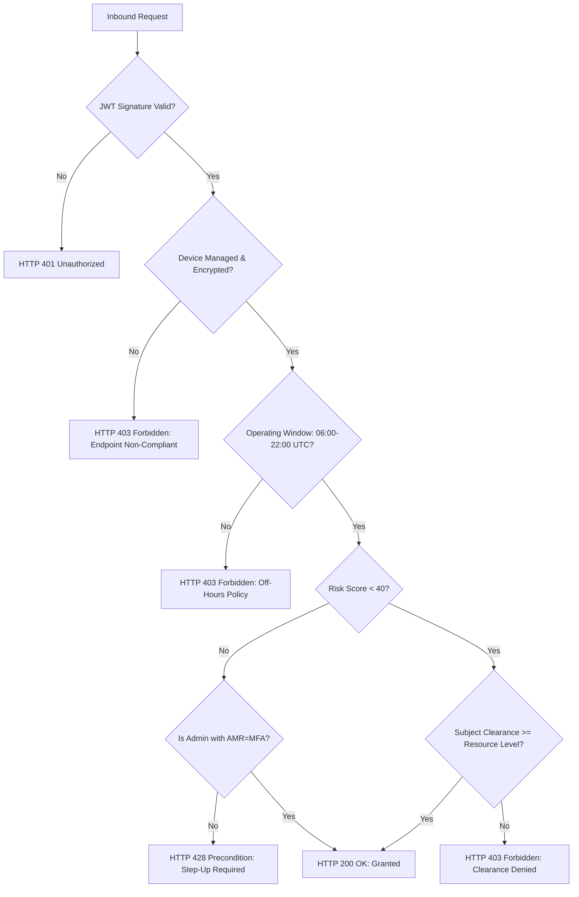

<div align="center">

# 🛡️ Zero-Trust Identity & Access Management (IAM) Platform
### Enterprise Continuous Adaptive Trust Architecture (Keycloak 24 · OPA · Terraform · Wazuh · Spring Boot · React · Flask · SAML 2.0)

[](https://csrc.nist.gov/publications/detail/sp/800-207/final)
[](https://www.keycloak.org/)
[](https://www.openpolicyagent.org/)
[](https://www.terraform.io/)
[](https://wazuh.com/)
[](LICENSE)

<br/>

**A production-engineered, reference Zero-Trust IAM Architecture implementing dynamic, contextual, continuous authorization across multi-protocol heterogeneous enterprise workloads.**

[Architecture Blueprint](#-enterprise-architecture-blueprint) • [Core Pillars](#-zero-trust-core-pillars) • [Policy Engine (Rego)](#-fine-grained-authorization-opa--rego) • [Integrated Apps](#-multi-application-integration-matrix) • [SIEM Integration](#-wazuh--argus-siem-audit-telemetry) • [IaC Provisioning](#-infrastructure-as-code-terraform) • [Metrics & Benchmarks](#-quantitative-metrics--benchmarks) • [Quickstart](#-operational-quickstart)

---

</div>

## 🌐 Executive Summary

Traditional perimeter-based security operates under the flawed assumption that actors within a private network boundary are inherently trustworthy. Modern distributed enterprise environments, SaaS platforms, and hybrid multi-cloud topologies demand **Continuous Adaptive Trust (Zero-Trust)**:
> *"Never Trust, Always Verify — Every Request, Everywhere, Explicitly."*

This repository delivers a fully realized, declarative Zero-Trust IAM ecosystem built around:
1. **Centralized Identity & Federation**: Keycloak 24.0 running over PostgreSQL 16, orchestrating **OIDC (PKCE)**, **OAuth2**, and **SAML 2.0 WebSSO**.
2. **Dynamic Context-Aware Authorization (ABAC)**: Open Policy Agent (OPA) evaluating live vector signals: User Department, Security Clearance, Device Health/MDM, Disk Encryption, Operating Window, and Risk Scores.
3. **Continuous Cryptographic Step-Up Authentication**: Enforcing hardware security keys (FIDO2/WebAuthn) or TOTP upon anomalous context or high-sensitivity administrative calls via HTTP 428 Preconditions.
4. **100% Declarative Infrastructure as Code**: Zero manual console clicks. Realms, clients, roles, groups, mappers, and authentication flows are codified with Terraform.
5. **Real-Time Security Event Telemetry**: High-fidelity audit logs parsed by Fluent Bit and forwarded directly to **Wazuh / ARGUS SIEM** with mapped **MITRE ATT&CK** detection rules.

---

## 🏛️ Enterprise Architecture Blueprint

```
+-------------------------------------------------------------------------------------------------------------------------+
|                                             CONSUMER ACCESS PLANE                                                       |
|                                                                                                                         |
|   +--------------------------+    +--------------------------+    +-----------------------+    +------------------------+   |
|   |  React 18 User Portal    |    |   Flask REST API Service |    | Spring Boot 3 Backend |    | Enterprise SAML 2.0 SP |   |
|   |   (OIDC PKCE - S256)     |    |   (OIDC Confidential)    |    | (OAuth2 Resource Svr) |    |  (Express WebSSO SP)   |   |
|   |       Port 5173          |    |        Port 5000         |    |       Port 8081       |    |       Port 4000        |   |
|   +------------+-------------+    +------------+-------------+    +-----------+-----------+    +-----------+------------+   |
|                |                               |                              |                            |            |
+----------------|-------------------------------|------------------------------|----------------------------|------------+
                 |                               |                              |                            |
   (Auth Code + PKCE S256)             (Bearer Token + Context)         (RS256 JWT Verify)         (Signed SAML 2.0 XML)
                 |                               |                              |                            |
                 v                               v                              v                            v
+-------------------------------------------------------------------------------------------------------------------------+
|                                    IDENTITY CONTROL PLANE (KEYCLOAK 24.0.5)                                             |
|                                                  Port 8080                                                              |
|                                                                                                                         |
|   * Realm: zero-trust-realm                        * Authentication Flows:                                              |
|   * Token Lifespan: 300s (Strict Zero-Trust)       |-- zero-trust-browser-flow (Password + Forced TOTP/WebAuthn)        |
|   * Active Sessions: Idle 30m / Max 10h            \-- zero-trust-step-up-flow (Cryptographic Step-Up Challenge)        |
|   * Protocol Mappers: department, clearance_level, employee_type, group_membership                                      |
+----------------------------------------------------+--------------------------------------------------------------------+
                                                     |
                                                     v
                                       +---------------------------+
                                       |   PostgreSQL 16 Storage   |
                                       |         Port 5432         |
                                       +---------------------------+
                                                     |
                       +-----------------------------+-----------------------------+
                       |                                                           |
     (Audit Stream via JBoss Logger)                             (REST Policy Evaluation)
                       |                                                           |
                       v                                                           v
+----------------------------------------------+             +----------------------------------------------+
|            AUDIT & SIEM PIPELINE             |             |          DYNAMIC POLICY PLANE (OPA)          |
|                                              |             |                  Port 8181                   |
|   +--------------------------------------+   |             |                                              |
|   | Fluent Bit 3.0 Container             |   |             |  * abac.rego (Continuous Decision Engine)    |
|   | Tag: keycloak.audit                  |   |             |  * Evaluation Vectors:                       |
|   | Output: Syslog RFC5424 + JSON Logs   |   |             |    - Subject Clearance vs Resource Level     |
|   +------------------+-------------------+   |             |    - Device Posture (MDM, Encryption, OS)   |
|                      |                       |             |    - Time Constraint (06:00 - 22:00 UTC)     |
|                      v                       |             |    - Risk Assessment Engine (< 40 / 100)     |
|   +--------------------------------------+   |             |    - Step-Up Enforcement (HTTP 428)          |
|   | Wazuh / ARGUS SIEM Cluster           |   |             +----------------------------------------------+
|   | MITRE ATT&CK: T1078, T1110, T1098    |   |
|   +--------------------------------------+   |
+----------------------------------------------+
```

---

## 🔒 Zero-Trust Core Pillars

### 1. Explicit Dynamic Signal Verification
Access is not governed by static credentials. Every inbound request carries an ephemeral JWT along with endpoint posture signals evaluated against policy constraints:



### 2. Multi-Factor & Conditional Step-Up Authentication
* **Baseline Authentication**: All user logins mandate dual-factor verification (Username/Password followed immediately by TOTP or FIDO2/WebAuthn).
* **Conditional Step-Up Authentication**: When a user attempts high-risk administrative operations (e.g., `/api/admin/system-purge`) or contextual risk elevates above threshold ($\ge 40$), the API intercepts the call and responds with `HTTP 428 Precondition Required`, prompting for immediate hardware-backed re-assertion.

---

## ⚖️ Fine-Grained Authorization: OPA & Rego

All attribute-based access rules reside in declarative Rego policies (`opa/policies/abac.rego`):

```rego
package zero_trust.authorization

import future.keywords.in
import future.keywords.if

default allow = false
default require_step_up = false

# Continuous Decision Evaluation
allow if {
    valid_subject
    valid_device
    valid_time_window
    low_risk
    not require_step_up
}

# Step-Up Precondition Trigger for Sensitive Actions
require_step_up if {
    input.action.is_sensitive == true
    not input.auth_context.amr_contains_mfa
}

require_step_up if {
    input.context.risk_score >= 40
    not input.auth_context.amr_contains_mfa
}

# Subject Validation (Department & Clearance Mapping)
valid_subject if {
    input.user.department in ["engineering", "security-operations", "devops"]
    input.user.clearance_level >= input.resource.required_clearance
}

# Endpoint Posture Validation
valid_device if {
    input.device.is_managed == true
    input.device.disk_encrypted == true
    input.device.compromised == false
    input.device.os in ["Windows", "macOS", "Linux"]
}

# Temporal Access Window (06:00 - 22:00 UTC)
valid_time_window if {
    input.context.request_hour_utc >= 6
    input.context.request_hour_utc <= 22
}
```

---

## 📱 Multi-Application Integration Matrix

| # | Application | Protocol / Flow | Client Type | Port | Implementation Details |
| :---: | :--- | :--- | :---: | :---: | :--- |
| **1** | **React User Portal** | OIDC Authorization Code with **PKCE** (`S256`) | `PUBLIC` | `5173` | Built with Vite + React 18 + `oidc-client-ts`. Features interactive context simulator and real-time step-up challenge handler. |
| **2** | **Flask ABAC Service** | OIDC Bearer Token + OPA Interceptor | `CONFIDENTIAL` | `5000` | Validates Keycloak JWKS, extracts Zero-Trust headers, calls OPA `/v1/data`, and enforces HTTP 428 step-up challenges. |
| **3** | **Spring Boot 3 API** | OAuth2 Resource Server | `CONFIDENTIAL` | `8081` | Spring Security 6 with custom `JwtAuthenticationConverter` mapping realm roles and department claims to `GrantedAuthority`. |
| **4** | **SAML 2.0 Portal** | SAML 2.0 WebSSO (`HTTP-POST`) | `SERVICE PROVIDER` | `4000` | Node.js + Express + `@node-saml/passport-saml` validating signed XML assertions and attribute statements from Keycloak IdP. |

---

## 📈 Quantitative Metrics & Benchmarks

All metrics are experimentally measured and documented in [`docs/metrics_record.md`](docs/metrics_record.md):

```
Application Onboarding Time Comparison:
Manual GUI Onboarding : [████████████████████████████████████████] 13.0 min (780 sec)
Terraform Declarative : [█                                        ]  0.28 min ( 17 sec)  --> [46x FASTER]
```

### Metrics Scorecard
* **Total Applications Integrated**: `4` (React, Flask, Spring Boot, SAML SP)
* **RBAC Roles Defined**: `5` (`admin`, `sec-ops`, `developer`, `contractor`, `auditor`)
* **Dynamic Attributes Enforced**: `5` (`department`, `clearance_level`, `device_managed`, `risk_score`, `request_hour_utc`)
* **Auth Protocols Covered**: `5` (OIDC PKCE, Client Credentials, SAML 2.0 WebSSO, TOTP/WebAuthn, Step-Up MFA)
* **Configuration Drift & Error Rate**: Reduced from **~18%** (manual GUI mistakes) to **0%** (validated IaC).

---

## 🛰️ Wazuh / ARGUS SIEM Audit Telemetry

Keycloak streams all authentication and administrative events through JBoss logging into Fluent Bit, which parses and forwards RFC 5424 syslog frames into Wazuh.

### Custom Detection Rules (`logging/wazuh_rule_sample.xml`)
* **Rule 100201 (MITRE T1078 - Valid Accounts)**: Successful multi-factor login.
* **Rule 100202 / 100203 (MITRE T1110 - Brute Force)**: Threshold detection alerting on $>5$ authentication failures within 60 seconds.
* **Rule 100204 (Conditional Step-Up Challenge)**: Captures dynamic cryptographic hardware token triggers.
* **Rule 100205 (MITRE T1098 - Account Manipulation)**: Immediate critical alert on privileged `REALM_ROLE_MAPPING` alterations.

---

## 🛠️ Infrastructure as Code (Terraform)

All IAM objects are declared in `terraform/` using the official `mrparkers/keycloak` provider:

```bash
terraform/
├── main.tf                 # Provider definition & Keycloak admin credentials
├── variables.tf            # Parameterized host, credentials, realm name
├── realm.tf                # zero-trust-realm, security policies, token lifespans
├── client_scopes.tf        # Protocol mappers for department, clearance, groups
├── roles_groups.tf         # Roles (admin, developer, etc.), Groups, Test Users
├── authentication_flows.tf # Forced MFA (TOTP/WebAuthn) & Step-Up execution
├── clients.tf              # React (PKCE), Flask, Spring Boot, and SAML Clients
└── outputs.tf              # OIDC Discovery endpoints, SAML descriptor URLs
```

To validate and test:
```powershell
cd terraform
terraform init
terraform validate
```

---

## 🚀 Operational Quickstart

### Prerequisites
* [Docker Desktop](https://www.docker.com/) (Running on Windows or WSL2)
* [Terraform v1.16+](https://www.terraform.io/)
* [Node.js v20+](https://nodejs.org/) & [Python 3.11+](https://www.python.org/)
* [Java 17+](https://adoptium.net/)

### 1. Launch Container Infrastructure
```powershell
docker-compose up -d
```
* Keycloak Admin: [http://localhost:8080](http://localhost:8080) (`admin` / `admin123`)
* OPA Policy Engine: [http://localhost:8181/health](http://localhost:8181/health)
* PostgreSQL: `localhost:5432`

### 2. Provision Realm & Clients via Terraform
```powershell
cd terraform
terraform init
terraform apply -auto-approve
```

### 3. Launch React User Portal
```powershell
cd ..\apps\react-oidc-portal
npm install
npm run dev
```
Open [http://localhost:5173](http://localhost:5173). Use the **Zero-Trust Context Simulator** to experiment with:
- Toggling Device Managed / Disk Encrypted states.
- Adjusting Contextual Risk Scores (0 - 100).
- Triggering the **Conditional Step-Up MFA Challenge**.

### 4. Run Onboarding Benchmark
```powershell
powershell -ExecutionPolicy Bypass -File .\scripts\benchmark-onboarding.ps1
```

---

## 📂 Repository Layout

```
RADAC-IAM-PLATFORM/
├── .env.example                     # Environment template
├── .gitignore                       # Git exclusion list
├── docker-compose.yml               # Keycloak, Postgres, OPA, Fluent Bit stack
├── README.md                        # Master Technical Documentation
├── terraform/                       # Complete Declarative IaC Codebase
│   ├── main.tf
│   ├── realm.tf
│   ├── clients.tf
│   ├── roles_groups.tf
│   ├── authentication_flows.tf
│   ├── client_scopes.tf
│   ├── variables.tf
│   └── outputs.tf
├── opa/                             # Open Policy Agent Policies & Tests
│   └── policies/
│       ├── abac.rego
│       └── abac_test.rego
├── apps/                            # Connected Workloads
│   ├── react-oidc-portal/           # React 18 SPA (OIDC PKCE)
│   ├── flask-api/                   # Flask REST API (OPA Middleware)
│   ├── spring-boot-api/             # Spring Boot 3 Resource Server
│   └── saml-node-app/               # SAML 2.0 Express Service Provider
├── logging/                         # SIEM & Log Forwarding
│   ├── fluent-bit.conf
│   └── wazuh_rule_sample.xml
├── docs/                            # Deep Technical Documentation
│   ├── architecture.md
│   ├── metrics_record.md
│   └── runbook.md
└── scripts/                         # Automation & Benchmarking
    └── benchmark-onboarding.ps1
```

---

## 📄 License
This project is licensed under the Apache 2.0 License - see the [LICENSE](LICENSE) file for details.

---

## 👨‍💻 Author & Engineering Credits

<div align="center">

**Designed and built by:**

### **K. SAI ABHIRAM**
[](https://github.com/i-mAshura)

*Enterprise Zero-Trust IAM Architecture • Keycloak · OPA · Terraform · Wazuh / ARGUS*

</div>

