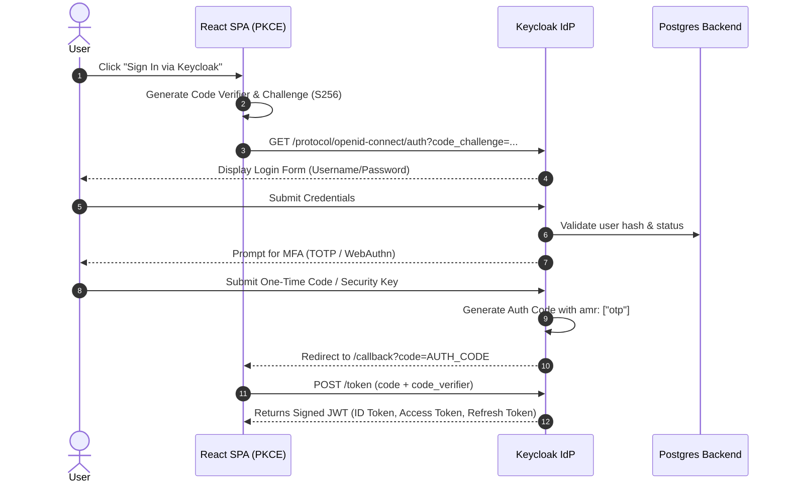
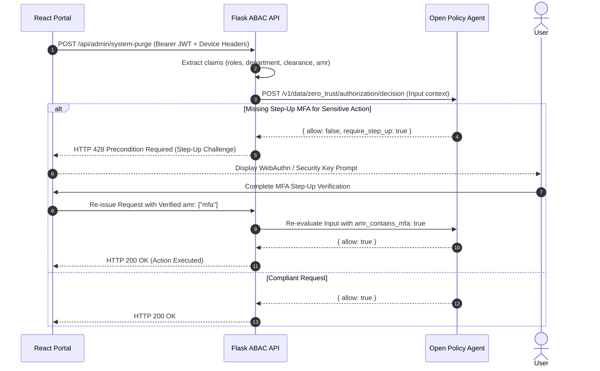

# Zero-Trust IAM Platform - Architecture Blueprint

## 1. Executive Overview

This platform implements a production-grade **Zero-Trust Identity and Access Management (IAM)** architecture designed around NIST SP 800-207 principles:
1. **Never Trust, Always Verify**: Every access request is dynamically inspected; network locality grants zero implicit trust.
2. **Explicit Attribute-Based Authorization (ABAC)**: Access is governed by subject clearance, department, device posture, time of day, and risk score via Open Policy Agent (OPA).
3. **Continuous Step-Up Authentication**: Elevated or sensitive actions dynamically require hardware token / TOTP re-authentication.
4. **Declarative Infrastructure as Code (IaC)**: Entire IAM fleet (realms, clients, roles, flows, policies) is provisioned via Terraform for immutable governance.
5. **Real-Time SIEM Ingestion**: All authentication and administrative events are streamed to Wazuh / ARGUS for continuous behavioral analysis and threat hunting.

---

## 2. System Architecture Diagram

```
+----------------------------------------------------------------------------------------------------+
|                                    ZERO-TRUST CLIENTS & CONSUMERS                                  |
|                                                                                                    |
|   +-----------------------+     +-----------------------+     +--------------------------------+   |
|   |   React User Portal   |     |     Flask REST API    |     |      Spring Boot API           |   |
|   |     (OIDC + PKCE)     |     |   (OIDC Confidential) |     |  (OAuth2 Resource Server)      |   |
|   |       Port 5173       |     |       Port 5000       |     |          Port 8081             |   |
|   +-----------+-----------+     +-----------+-----------+     +---------------+----------------+   |
|               |                             |                                 |                    |
|               |                             |                                 |                    |
|               | (OIDC PKCE Flow)            | (Bearer JWT Verification)       | (JWT Validation)   |
|               v                             v                                 v                    |
|   +--------------------------------------------------------------------------------------------+   |
|   |                       ENTERPRISE IDENTITY PROVIDER (KEYCLOAK 24)                          |   |
|   |                                        Port 8080                                           |   |
|   |  * zero-trust-realm               * TOTP / WebAuthn MFA Flow                               |   |
|   |  * RBAC Roles: admin, dev, secops * Custom Client Scopes (department, clearance, amr)      |   |
|   +-----------------+-------------------------------------------------+------------------------+   |
|                     |                                                 |                            |
+---------------------|-------------------------------------------------|----------------------------+
                      |                                                 |
                      v                                                 v
        +---------------------------+                     +---------------------------+
        |   PostgreSQL 16 Database  |                     |  SAML 2.0 Service Provider|
        |      Keycloak Backend     |                     |     (Node/Express SP)     |
        |         Port 5432         |                     |         Port 4000         |
        +---------------------------+                     +---------------------------+
                      |
                      | (Audit Event Stream via JBoss Logger)
                      v
        +---------------------------+                     +---------------------------+
        |   Fluent Bit Log Shipper  | =================>  |     Wazuh / ARGUS SIEM    |
        |   Tag: keycloak.audit     |    (Syslog RFC5424) |      Security Monitoring  |
        +---------------------------+                     +---------------------------+
                      ^
                      | (ABAC Policy Inquiries)
        +---------------------------+
        |  Open Policy Agent (OPA)  |
        |      Rego Policy Engine   |
        |         Port 8181         |
        +---------------------------+
```

---

## 3. Core Zero-Trust Sequences

### A. OIDC PKCE Login with MFA Enforcement


### B. Request Authorization with OPA ABAC & Step-Up Auth


---

## 4. Zero-Trust Claims & Attribute Specification

| Claim / Attribute | Source | Format | Purpose in OPA Policy |
| :--- | :--- | :--- | :--- |
| `department` | User Profile / Group | String (`engineering`, `secops`) | Verifies domain eligibility |
| `clearance_level` | User Profile | Integer (`1` to `4`) | Enforces data classification boundaries |
| `roles` | Realm Role Mapping | Array of Strings | Provides base RBAC permissions |
| `amr` / `acr` | Keycloak Auth Context | Array (`["pwd", "otp"]`) | Enforces MFA & Step-up preconditions |
| `is_managed` | Endpoint Gateway Header | Boolean | Validates MDM/EDR enrollment |
| `disk_encrypted` | Endpoint Gateway Header | Boolean | Validates cryptographic storage posture |
| `risk_score` | Risk Engine Context | Integer (`0` to `100`) | Blocks access if risk >= 40 |
| `request_hour_utc` | Network Timestamp | Integer (`0` to `23`) | Enforces work hours (06:00 - 22:00 UTC) |
